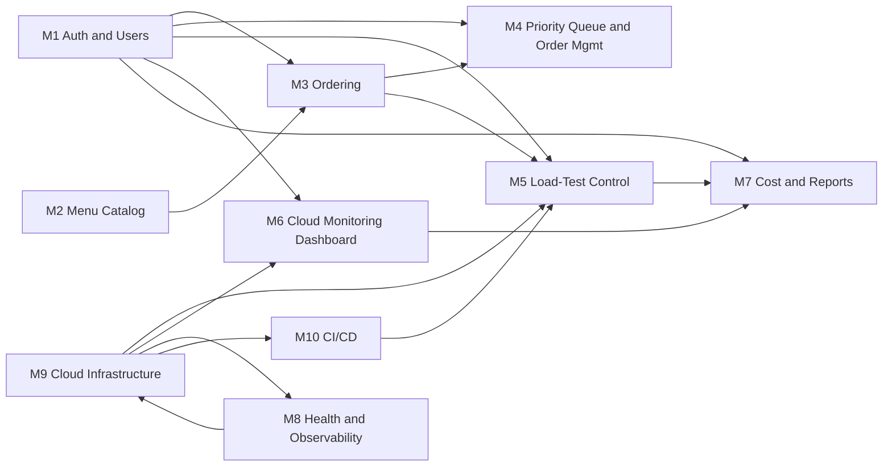

# 01 – Requirement Analysis (Task 1)

**Source of truth:** `FeastFlow_SRS_FRS.pdf` (OBJ-01..04, FR-01..15, NFR-01..07, SLA-01..02, AC-01..04, CON-01..03, DEL-01..02).
Anything not stated in that document is marked **[ASSUMPTION]** or **[OPTIONAL]**.

---

## 1. User Roles & Actors

| Actor | Type | Description | Source |
|---|---|---|---|
| **Customer – Free** | Human, app role `CUSTOMER` | Registers, signs in, browses menu, places orders, views own orders. Orders queued at normal priority. | FR-01, FR-02 |
| **Customer – Premium** | Human, app role `CUSTOMER` + `subscription_tier = PREMIUM` | Same as Free, but orders are placed ahead of Free orders in the processing queue. | FR-01, FR-05, CON-02 |
| **Administrator** | Human, app role `ADMIN` | Views incoming orders + priority, updates status, runs load-test scenarios, views cloud dashboard and cost estimates. | FR-03, FR-04, FR-07, FR-10, FR-15 |
| Load generator (Locust) | System actor | Generates normal-day and festival-day traffic against the ALB. | FR-07, OBJ-02 |
| CI/CD pipeline | System actor | Builds, tests and deploys code on push. | FR-14, AC-03 |
| AWS control plane (CloudWatch / ASG) | System actor | Collects metrics, fires alarms, scales the instance fleet. | FR-09, FR-11 |

> **Key design rule (CON-02):** *Free vs Premium is a column in the application database, not an IAM concept.*
> IAM (FR-12) only governs which AWS resources the **application components** may access.
> There are exactly **two application roles** (`CUSTOMER`, `ADMIN`); Free/Premium is a subscription attribute of a customer.

---

## 2. Functional Modules

| # | Module | Functionalities | Requirements covered |
|---|---|---|---|
| M1 | **Auth & User Management** | Register, sign in (JWT), view profile, Free/Premium tier, role-based route guards, admin can change a user's tier | FR-01, NFR-04, CON-02 |
| M2 | **Menu Catalog** | List single-restaurant menu items, item images served from S3 | FR-02, FR-13 |
| M3 | **Ordering** | Cart (client-side), submit order (atomic transaction, server-side pricing), list/view own orders | FR-02, FR-06, NFR-05 |
| M4 | **Priority Queue & Order Management** | Priority snapshot at order time, admin queue sorted Premium-first then FIFO, "claim next" with row locking, status transitions Pending → Preparing → Completed, status history | FR-03, FR-04, FR-05, FR-06, NFR-05, AC-01 |
| M5 | **Load-Test Control** | Admin launches **Normal-day** / **Festival-day** scenario, stop, view results, persist run summary | FR-07, OBJ-02, NFR-01, AC-02 |
| M6 | **Cloud Monitoring Dashboard** | CPU, memory, request count, latency, 5xx, healthy hosts, instance list, scaling activities, alarm states | FR-08, FR-09, FR-10, FR-11, SLA-02 |
| M7 | **Cost & Reports** | Estimated cost per period / per load-test run, resource usage, generate report → S3, download via pre-signed URL | FR-13, FR-15, NFR-07, AC-04, OBJ-04 |
| M8 | **Health & Observability** | `/api/health` (liveness), `/api/health/ready` (DB check), structured JSON logs → CloudWatch Logs, request-ID and served-by-instance headers | NFR-06, NFR-02 |
| M9 | **Cloud Infrastructure** | VPC/SGs, ALB, ASG + launch template, RDS, S3, ECR, IAM (LabRole), CloudWatch agent + alarms | FR-08, FR-09, FR-11, FR-12, FR-13, NFR-03 |
| M10 | **CI/CD** | Lint + test + build image + push + rolling deploy (ASG instance refresh) + smoke test | FR-14, AC-03, DEL-02 |

---

## 3. System Components

| Layer | Component | Technology (per SRS §4) |
|---|---|---|
| Frontend | Single-page app (Customer + Admin portals) | React |
| Backend | REST API, priority queue logic, AWS read adapters | Python FastAPI |
| Database | Relational store for users, menu, orders, history, load-test runs, reports | PostgreSQL on Amazon RDS (if permitted) |
| Compute | Containerised app on EC2 instances | Amazon EC2 + Docker |
| Traffic | Load distribution + elasticity | Application Load Balancer + EC2 Auto Scaling |
| Monitoring | Metrics, logs, alarms, (optional) notifications | Amazon CloudWatch (+ SNS optional) |
| Access / Storage | Cloud permissions, asset & report storage | AWS IAM + Amazon S3 |
| CI/CD | Build/test/deploy | GitHub + GitHub Actions (CodePipeline/CodeBuild as alternative "if permitted") |
| Load testing | Traffic simulation | Locust |

## 4. Frontend / Backend / Database / AWS Mapping

| Concern | Frontend (React) | Backend (FastAPI) | Database (PostgreSQL) | AWS service |
|---|---|---|---|---|
| Sign up / sign in | Forms, token storage, route guards | `/auth/*`, bcrypt, JWT, role deps | `users` | — |
| Menu | Menu grid, cart | `/menu` | `menu_items` | S3 (images) |
| Orders | Checkout, "My Orders" | `/orders`, transaction | `orders`, `order_items`, `order_status_history` | RDS |
| Priority queue | Admin queue view | Queue service (`ORDER BY priority DESC, created_at`), `SKIP LOCKED` | index on `(status, priority, created_at)` | — (app logic only) |
| Load tests | Scenario buttons + run results | `/admin/load-tests` → Locust HTTP API | `load_test_runs` | EC2 (Locust), ALB, ASG |
| Dashboard | Charts | `/admin/cloud/*` (boto3, cached) | — | CloudWatch, ELBv2, Auto Scaling APIs |
| Cost | Cost page | `/admin/costs` (rate table × usage) | `load_test_runs`, `reports` | CloudWatch (usage), S3 (reports) |
| Deploy | — | Docker image | Alembic migrations | ECR, ASG instance refresh |

---

## 5. Module Dependencies

| Module | Depends on | Why |
|---|---|---|
| M3 Ordering | M1, M2 | Needs authenticated customer + valid menu items/prices |
| M4 Priority Queue | M1, M3 | Priority derived from user's tier at order time; operates on orders |
| M5 Load-Test Control | M1, M3, M9, M10 | Admin-only; Locust exercises order APIs; needs ALB/ASG/Locust EC2 deployed |
| M6 Dashboard | M1, M9 | Admin-only; reads CloudWatch/ASG/ALB data |
| M7 Cost & Reports | M5, M6 | Costs derive from instance-hours & load-test windows; reports written to S3 |
| M9 Infrastructure | M8 | ALB/ASG health checks rely on `/api/health` |
| M10 CI/CD | M9 | Deploys into ECR + ASG |

**Critical path:** M1 → M2 → M3 → M4 (core app, AC-01) → M8 → M9 → M10 (AC-03) → M5 → M6 (AC-02) → M7 (AC-04).

---

## 6. Requirement Traceability (FRS/SRS → Design)

| Req | Design element | Doc |
|---|---|---|
| FR-01 | `users.subscription_tier`, `/auth/register`, `/auth/login` | 08, 09 |
| FR-02 | `menu_items`, `POST /orders` | 08, 09 |
| FR-03 | `GET /admin/orders`, `GET /admin/orders/queue` (shows priority) | 09 |
| FR-04 | `PATCH /admin/orders/{id}/status`, state machine | 04, 09 |
| FR-05 | `orders.priority` snapshot + queue ordering + `SKIP LOCKED` claim | 08 |
| FR-06 | `users`, `orders`, `order_items`, `order_status_history` | 05, 08 |
| FR-07 | `POST /admin/load-tests` → Locust EC2 | 13 |
| FR-08 | ALB + target group + health check | 02 |
| FR-09 | ASG target-tracking (CPU 50 %), min 2 / max 4 | 02, 13 |
| FR-10 | `/admin/cloud/metrics`, `/instances`, `/scaling-activities` | 09 |
| FR-11 | CloudWatch agent, metrics, alarms (+ SNS optional) | 02, 12 |
| FR-12 | LabRole / LabInstanceProfile + security groups + S3 bucket policy | 12 |
| FR-13 | S3 bucket `menu/` and `reports/` prefixes | 02, 08 |
| FR-14 | GitHub Actions CI + CD (ECR push, instance refresh) | 02, 04 |
| FR-15 | `/admin/costs/estimate`, cost report to S3 | 09, 12 |
| NFR-01 | Stateless containers, horizontal scaling, connection pool sizing | 03, 08 |
| NFR-02 | Min 2 instances across 2 AZs, SLA measurement method | 13 |
| NFR-03 | ASG max 4, Learner Lab caps, cost guardrails | 12 |
| NFR-04 | bcrypt + JWT + role dependencies | 06 |
| NFR-05 | Transactions, conditional status updates, `SELECT … FOR UPDATE SKIP LOCKED` | 06, 08 |
| NFR-06 | Health endpoints, JSON logs → CloudWatch Logs | 03 |
| NFR-07 | Locust stats + CloudWatch + cost estimate stored per run | 13 |
| SLA-01/02, AC-04 | SLA definition + scenario comparison report | 13 |
| CON-01 | Learner Lab constraint register | 12 |
| CON-02 | Tier in DB, not IAM | this doc §1 |
| CON-03 | No payment, delivery tracking, multi-restaurant | §7 |

---

## 7. Explicitly Out of Scope (CON-03)

- Payment gateways or any payment capture (order `total_amount` is informational only).
- Delivery tracking, rider assignment, maps.
- Multiple restaurants / multi-restaurant logistics (a single implicit restaurant).
- Real subscription billing (Premium is a flag set without payment).

## 8. Ambiguities Resolved by Assumption

| ID | Gap in FRS/SRS | Decision |
|---|---|---|
| A-01 | How a user becomes Premium | **[ASSUMPTION]** Tier is chosen at registration and may be toggled by the customer (simulated, no payment) or by an admin. |
| A-02 | Who manages the menu | **[ASSUMPTION]** Menu is seeded via a database migration. Admin menu CRUD is **[OPTIONAL]**, not required by FRS. |
| A-03 | How admins are created | **[ASSUMPTION]** One admin is seeded from environment config; public registration always creates `CUSTOMER`. |
| A-04 | What "processing queue" means | Queue = `PENDING` orders ordered by `priority DESC, created_at ASC`. Admin "Start next" claims the head of the queue atomically. |
| A-05 | Premium upgrade after ordering | Priority is **snapshotted** on the order at creation time. Later tier changes do not reorder existing orders. |
| A-06 | Source of "estimated AWS costs" | Cost Explorer is generally unavailable in Learner Lab, so the app computes estimates from a **published on-demand rate table × measured usage**. |
| A-07 | Memory metrics | EC2 doesn't publish memory by default, so the **CloudWatch agent** runs on each instance. |
| A-08 | HTTPS | No custom domain/ACM certificate in Learner Lab, so the **ALB listener is HTTP :80**. This is documented as a lab limitation. |
| A-09 | Where load tests run | Dedicated Locust EC2 instance **outside** the ASG, so load generation doesn't distort app metrics. |
| A-10 | Region | `us-east-1` (Learner Lab supports `us-east-1` / `us-west-2`). |
