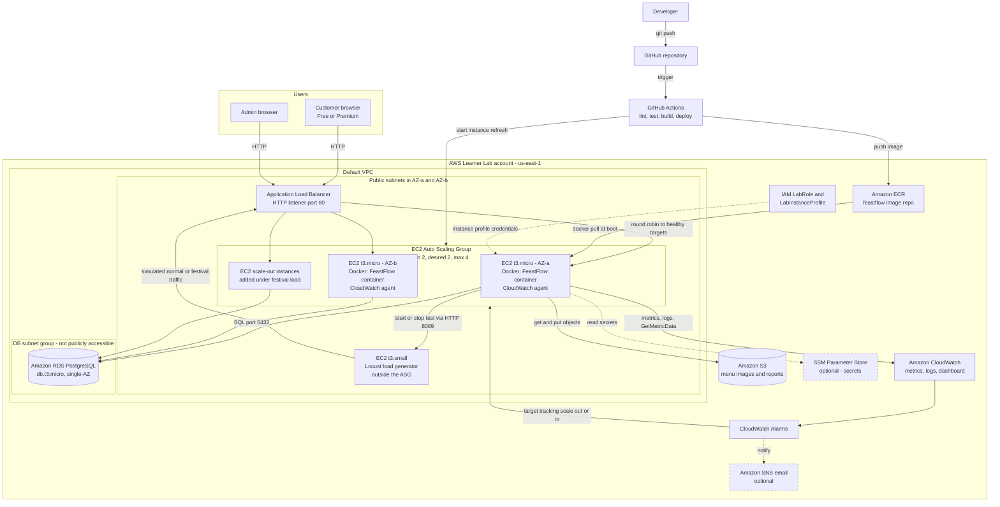

# 02 – High-Level AWS Architecture

Region: **us-east-1** (Learner Lab). Dashed boxes are **[OPTIONAL]** services.

## Component Summary

| Component | Configuration | Purpose | Status |
|---|---|---|---|
| Default VPC | 2 public subnets (AZ-a, AZ-b) | Avoids NAT Gateway cost, which isn't required | Required |
| Application Load Balancer | Internet-facing, HTTP :80 → target group port 8000, health check `GET /api/health` (15 s interval, 2 healthy / 3 unhealthy), deregistration delay 30 s, no stickiness | FR-08 | Required |
| Launch Template | Amazon Linux 2023, t3.micro, `LabInstanceProfile`, detailed monitoring ON, IMDSv2 required, user-data boots container | FR-09 | Required |
| Auto Scaling Group | 2 AZs, min 2 / desired 2 / max 4, health check type **ELB**, grace 180 s, default warm-up 120 s, **target tracking: ASGAverageCPUUtilization = 50 %**, group metrics collection ON | FR-09, NFR-02, NFR-03 | Required |
| EC2 + Docker | One container per instance (`feastflow-app`), port 8000, `--restart always`, `awslogs` log driver | SRS compute | Required |
| RDS PostgreSQL | PostgreSQL 16, db.t3.micro, 20 GB gp3, single-AZ, not public, automated backups 1 day | FR-06 | Required (if permitted). Fallback: Postgres container on a dedicated EC2 |
| S3 | Private bucket `feastflow-<acct>-assets`, prefixes `menu/` and `reports/`, Block Public Access ON, SSE-S3 | FR-13 | Required |
| ECR | Private repo `feastflow`, lifecycle rule keeps the last 10 images | FR-14 | Recommended (fallback: GHCR) |
| CloudWatch | EC2/ALB/ASG/RDS metrics, CWAgent `mem_used_percent`, log group `/feastflow/app` (7-day retention), dashboard `FeastFlow` | FR-10, FR-11 | Required |
| CloudWatch Alarms | See table below | FR-11 | Required |
| IAM | `LabInstanceProfile` (EC2), `LabRole` (CodeBuild if used). App-level RBAC is separate. | FR-12, CON-02 | Required (Learner Lab-provided) |
| Locust EC2 | t3.small, Locust 2.x web/API on 8089, outside ASG | FR-07 | Required |
| SNS | Email topic `feastflow-alerts` | FR-11 ("optional SNS") | **[OPTIONAL]** |
| SSM Parameter Store | `/feastflow/db_password`, `/feastflow/jwt_secret` (SecureString) | Secrets out of user-data | **[OPTIONAL]**, recommended |

## Security Groups (network-level least privilege)

| SG | Inbound | Source |
|---|---|---|
| `sg-alb` | TCP 80 | 0.0.0.0/0 |
| `sg-app` | TCP 8000 | `sg-alb` only |
| `sg-rds` | TCP 5432 | `sg-app` only |
| `sg-locust` | TCP 8089 | `sg-app` (backend control) + your IP (Locust UI, optional) |
| all | SSH 22 | **Not opened.** Use EC2 Instance Connect / Session Manager if permitted. |

## CloudWatch Alarms

| Alarm | Metric | Threshold | Action |
|---|---|---|---|
| `TargetTracking-*-AlarmHigh/Low` | ASG avg CPU | auto-created by target tracking (50 %) | Scale out / in |
| `feastflow-high-cpu` | ASG avg CPUUtilization | > 75 % for 3 × 1 min | Dashboard + SNS (optional) |
| `feastflow-unhealthy-hosts` | ALB UnHealthyHostCount | ≥ 1 for 2 × 1 min | Dashboard + SNS |
| `feastflow-5xx-rate` | HTTPCode_Target_5XX_Count / RequestCount | > 5 % for 3 × 1 min | Dashboard + SNS |
| `feastflow-high-latency` | ALB TargetResponseTime p90 | > 1.0 s for 3 × 1 min | Dashboard + SNS |
| `feastflow-high-memory` | CWAgent mem_used_percent | > 85 % for 3 × 1 min | Dashboard + SNS |
| `feastflow-rds-cpu` | RDS CPUUtilization | > 80 % for 5 × 1 min | Dashboard + SNS |

## Request Path (summary)

1. The browser calls `http://<alb-dns>/` and the ALB forwards to a healthy instance on port 8000.
2. The container serves the React build for non-API paths and FastAPI for `/api/*`. Using a single origin avoids CORS.
3. FastAPI validates the JWT, runs business logic, and queries RDS through a connection pool.
4. Every response carries `X-Served-By: <instance-id>`, which makes ALB load distribution visible (AC-02).

## Why this shape

- **Stateless app tier.** JWT auth means no server sessions, so any instance can serve any request, and scale-in or instance refresh is safe.
- **One image for frontend and backend.** A multi-stage Docker build gives one artifact, one deploy, and one health check. It's the lightest viable option.
- **Priority stays in the application.** Premium ordering lives in SQL ordering + row locks (FR-05, CON-02). No SQS, IAM or extra infrastructure is involved.
- **Locust sits outside the ASG.** Generator CPU doesn't pollute the scaling metric.
