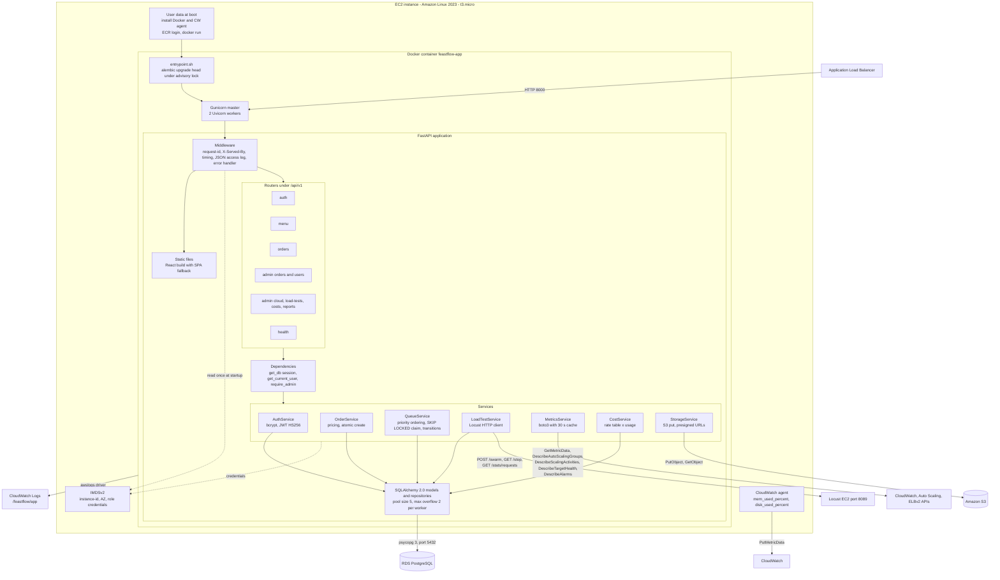
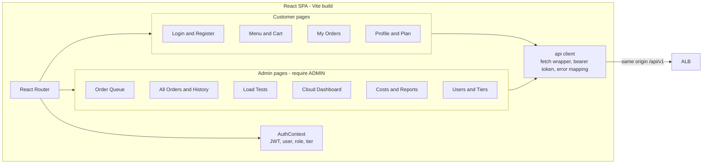
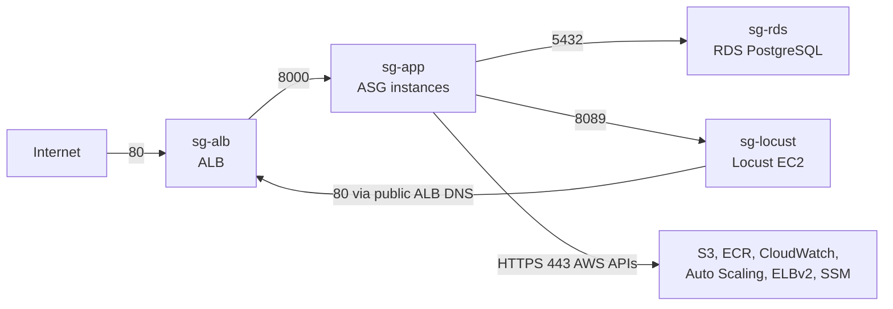

# 03 – Low-Level System Architecture

## 3.1 Runtime view of one application instance

## 3.2 Frontend (React SPA) structure

## 3.3 Network and security boundaries

## 3.4 Key low-level decisions

| Topic | Decision | Reason |
|---|---|---|
| Process model | Gunicorn + 2 Uvicorn workers per t3.micro (2 vCPU, 1 GiB) | Uses both vCPUs within memory limits |
| DB connections | Per worker: pool 5 + overflow 2 = 7. Per instance: 14. At max 4 instances: **56**. db.t3.micro allows about 80–110. | Prevents connection exhaustion during festival scale-out (NFR-01) |
| Migrations | `alembic upgrade head` in entrypoint, wrapped in `pg_advisory_lock` | Several instances can boot at once, and the pipeline can't reach the private RDS |
| Health checks | `/api/health` = liveness (no DB), used by the ALB. `/api/health/ready` = DB ping, used by dashboard and smoke test. | A brief DB outage won't make the ASG terminate every instance |
| Instance identity | Read `instance-id` and `placement/availability-zone` via IMDSv2 once at startup, return in `X-Served-By` and `/api/health` | Demonstrates load distribution (AC-02) |
| Version | `GIT_SHA` build arg baked into image env, returned by `/api/health` | CD smoke test verifies the new version is live (AC-03) |
| AWS API usage | All boto3 reads cached in-process for 30 s | Limits throttling and GetMetricData cost when multiple admins poll |
| Logging | JSON lines to stdout (`ts, level, request_id, instance_id, method, path, status, latency_ms, user_id`). Docker `awslogs` sends them to `/feastflow/app`. | NFR-06, troubleshooting by request-id |
| Secrets | DB password and JWT secret come from SSM Parameter Store at boot **[OPTIONAL]**. Fallback is launch-template user-data env. | Learner Lab simplicity vs hygiene |
| Config | 12-factor env vars: `DATABASE_URL`, `JWT_SECRET`, `S3_BUCKET`, `ASG_NAME`, `TARGET_GROUP_ARN`, `ALB_ARN_SUFFIX`, `LOCUST_URL`, `AWS_REGION` | Same image for every environment |
