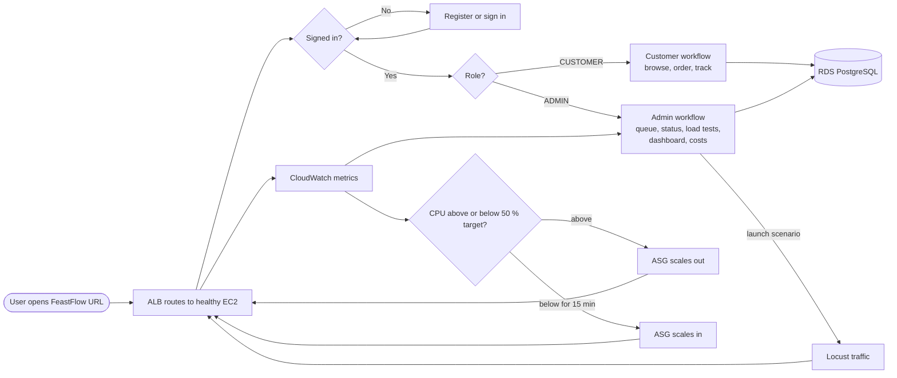
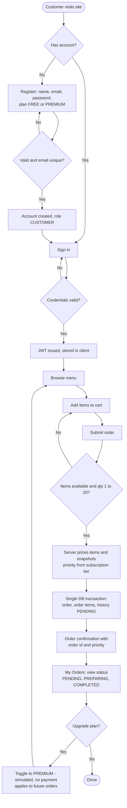
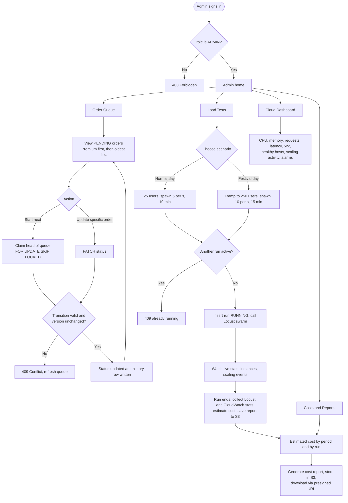
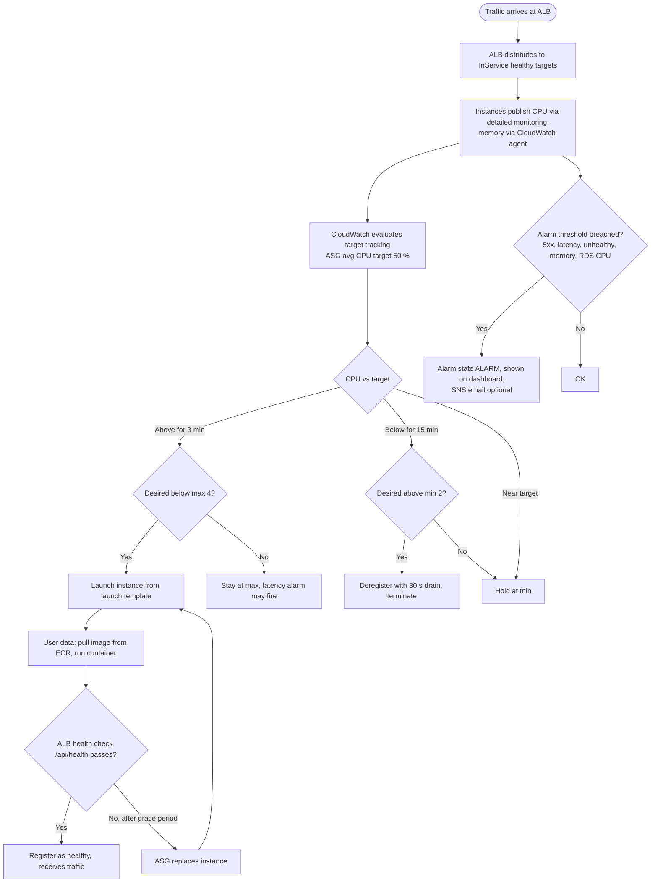
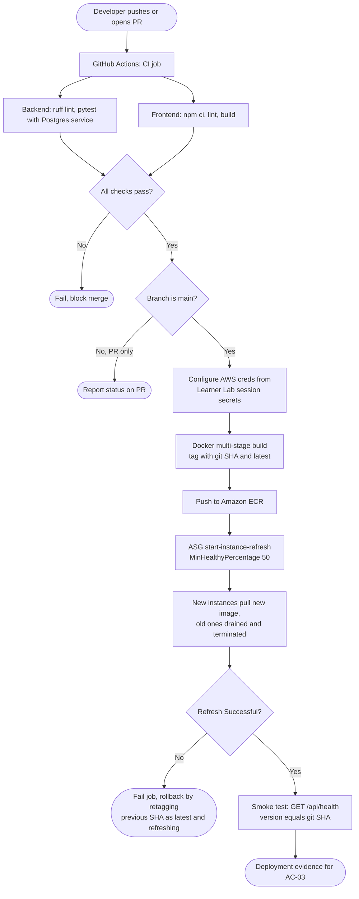
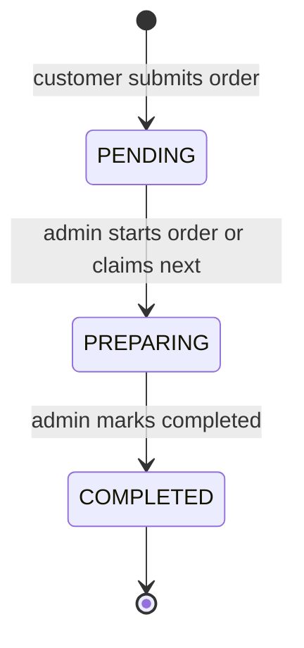

# 04 – Complete Project Flowchart

This doc has five parts: (1) the end-to-end overview, (2) the customer workflow, (3) the admin workflow, (4) the cloud workflows (scaling, monitoring, CI/CD), and (5) the order status state machine.

## 4.1 End-to-end overview

## 4.2 Customer workflow

## 4.3 Admin workflow

## 4.4 Cloud workflows

### 4.4.1 Auto scaling and monitoring

### 4.4.2 CI/CD pipeline

## 4.5 Order status state machine (FR-04)

Only forward transitions are allowed. Any other transition, such as `COMPLETED → PENDING` or skipping straight to `PENDING → COMPLETED`, returns **409 Conflict**.
