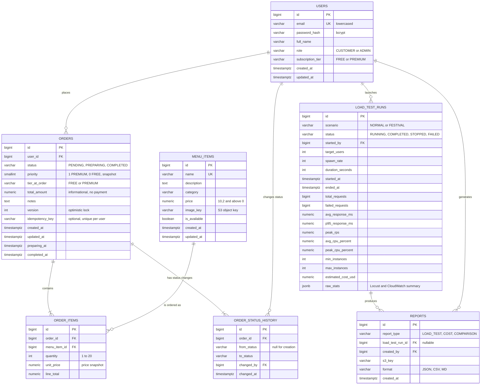

# 05 – Database ER Diagram

Engine: **PostgreSQL 16** on Amazon RDS. Column-level detail, constraints, and indexes are in [08-database-design.md](08-database-design.md).

## Relationships

| Relationship | Cardinality | Rule |
|---|---|---|
| USERS → ORDERS | 1 : 0..N | Only `CUSTOMER` users place orders. `ON DELETE RESTRICT`. |
| ORDERS → ORDER_ITEMS | 1 : 1..N | Every order has at least one item. `ON DELETE CASCADE`. |
| MENU_ITEMS → ORDER_ITEMS | 1 : 0..N | Price is copied into `unit_price`, so later menu price changes don't alter history. `ON DELETE RESTRICT`. |
| ORDERS → ORDER_STATUS_HISTORY | 1 : 1..N | Creation writes a `NULL → PENDING` row, and every transition appends one (FR-06). |
| USERS → ORDER_STATUS_HISTORY | 1 : 0..N | `changed_by` is the customer for creation and the admin for transitions. |
| USERS → LOAD_TEST_RUNS | 1 : 0..N | Admin who launched the scenario. |
| LOAD_TEST_RUNS → REPORTS | 1 : 0..N | Report rows for a run. Cost/comparison reports may have `NULL` run. |
| USERS → REPORTS | 1 : 0..N | Admin who generated the report. |
