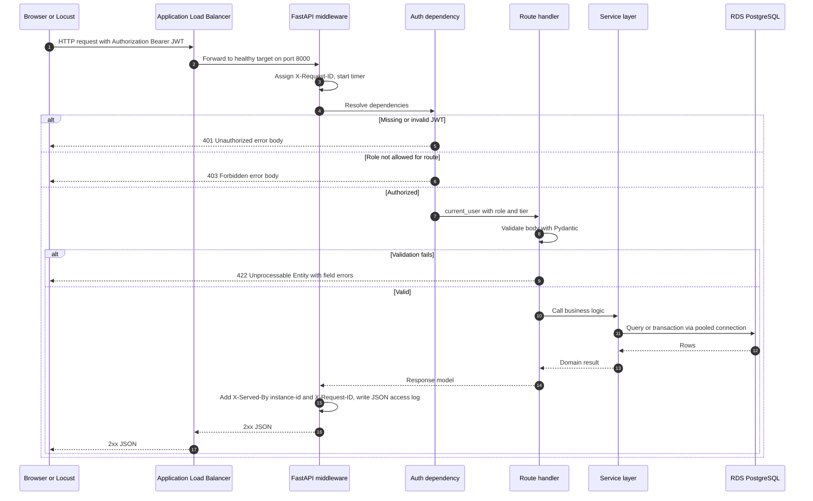
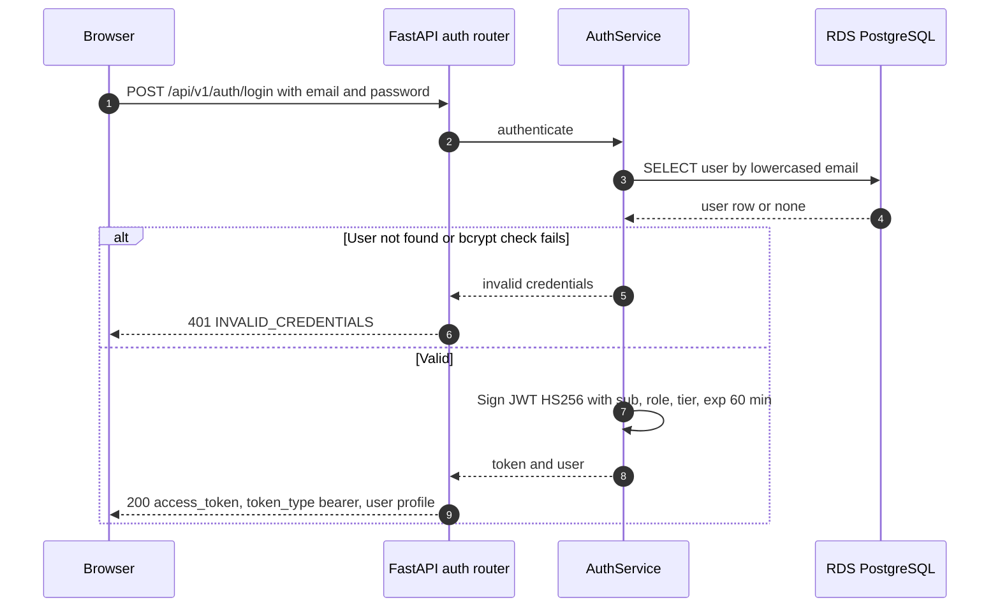
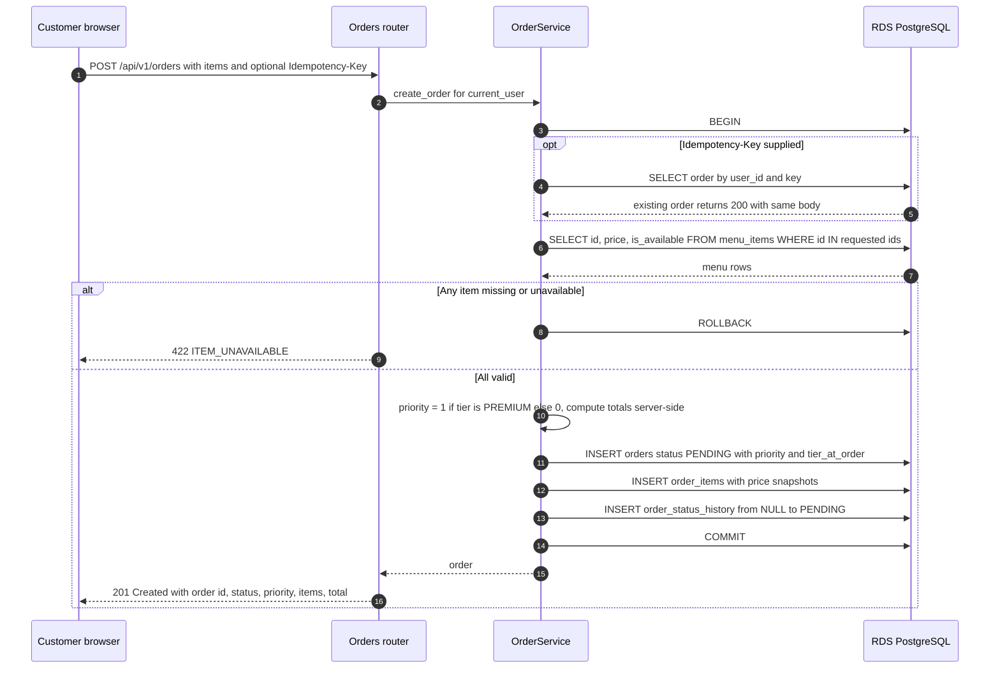
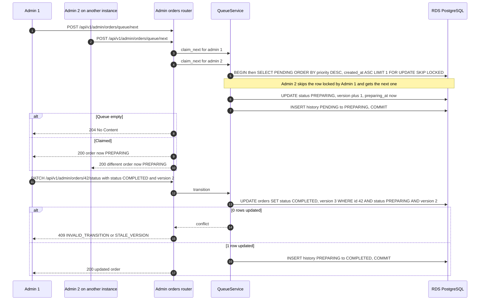
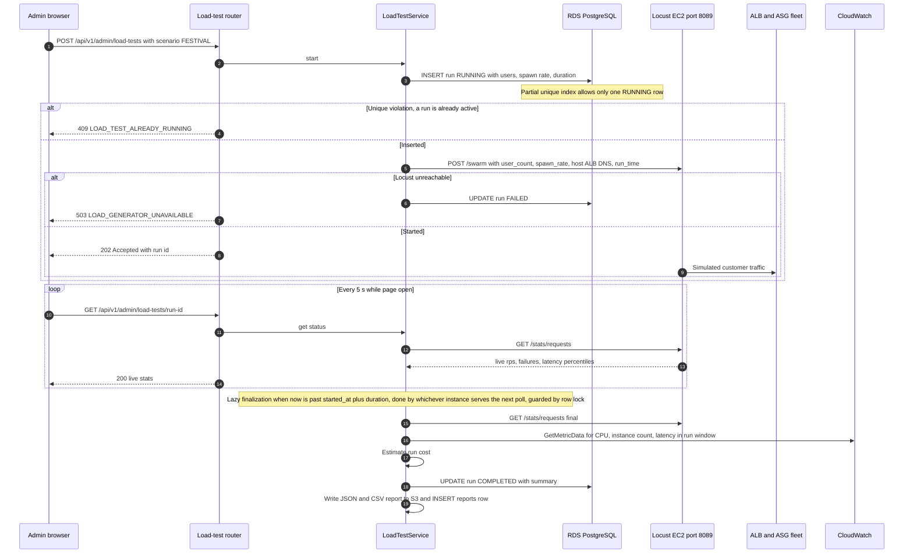
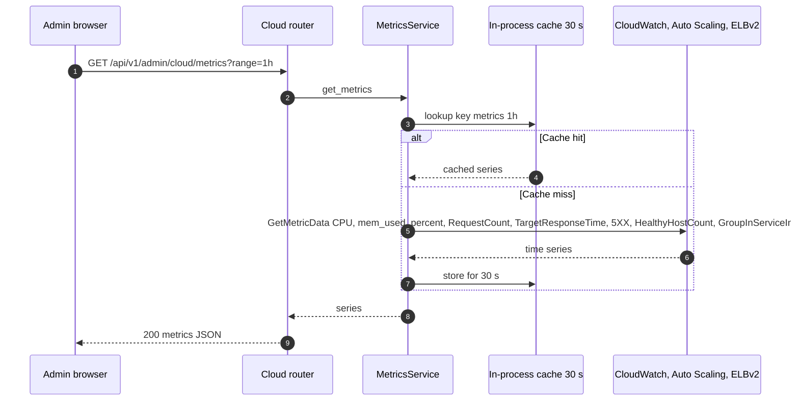

# 06 – API Request & Response Workflow

## 6.1 Generic request lifecycle (every `/api/v1` call)



## 6.2 Sign in (FR-01, NFR-04)



## 6.3 Place order (FR-02, FR-05, FR-06, NFR-05)



## 6.4 Admin claims next order & updates status (FR-03, FR-04, FR-05, NFR-05)



## 6.5 Launch load-test scenario (FR-07)



## 6.6 Cloud dashboard metrics (FR-10, FR-11)



## 6.7 Response conventions

**Success**: resource or list.

```json
{ "items": [ { "id": 101, "status": "PENDING", "priority": 1 } ], "page": 1, "page_size": 20, "total": 134 }
```

**Error**: same shape for every non-2xx.

```json
{
  "error": { "code": "INVALID_TRANSITION", "message": "Order 42 cannot move from COMPLETED to PREPARING", "details": null },
  "request_id": "6f1c2e7a-..."
}
```

**Headers on every response:** `X-Request-ID`, `X-Served-By: i-0abc123 (us-east-1a)`.

| HTTP | When |
|---|---|
| 200 / 201 / 202 / 204 | OK / created / async started (load test) / empty queue |
| 401 | Missing, expired or invalid JWT, or bad credentials |
| 403 | Authenticated but wrong role (customer calling `/admin/*`) |
| 404 | Resource not found, or a customer requesting another user's order (no existence leak) |
| 409 | Duplicate email, invalid status transition, stale version, load test already running |
| 422 | Request validation failure, unavailable menu item |
| 503 | DB unreachable (`/health/ready`), Locust unreachable |
| 500 | Unhandled. Logged with request-id, generic message returned. |
