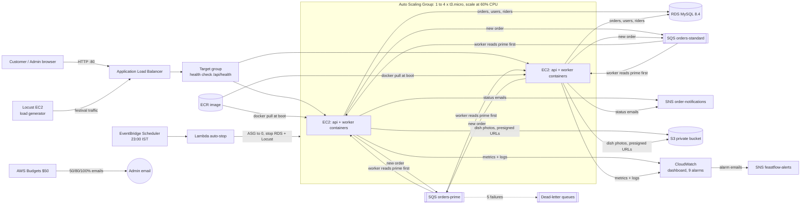

# FeastFlow: Scalable Food Ordering on AWS

**Cloud computing project report** · Deployed on AWS Academy Learner Lab (us-east-1) · November 2026

---

## 1. Introduction

FeastFlow is a food-ordering web application built to show how a cloud system handles a sudden
rush of orders, like a festival evening, without slowing down for its best customers or falling over.

It has two sides:
- **Customers** register, browse restaurants and dishes (photos stored in S3), place orders, follow
  each order live from "Placed" to "Delivered", and can buy a **Prime** subscription so their orders
  are handled first.
- **Admin / dispatch** sees every order arrive, delivery partners (riders) are **assigned automatically**,
  and a **Festival mode** floods the system with orders or with real HTTP traffic to test it.

The goals were:
1. A working end-to-end ordering system on real AWS services.
2. **Prime orders served before standard orders**, even when riders run out.
3. **Automatic scaling** when traffic rises, and scaling back down afterwards to save money.
4. **Load balancing** across all running servers.
5. **Monitoring and alerts** for problems and for cost.
6. Stay inside the **$50 Learner Lab credit**.

## 2. Architecture

**How a request flows:** the browser talks only to the load balancer. The ALB sends each request to
a healthy EC2 instance in the Auto Scaling Group. Every instance runs two Docker containers from the
same image: the **API** (FastAPI, also serves the React site) and the **order worker**. So adding an
instance adds both web capacity and order-processing capacity.

**How an order flows:**
1. `POST /api/orders` checks the items, computes the price on the server, saves the order in MySQL
   (status `PLACED`) and puts a message on **`orders-prime`** (Prime customer) or **`orders-standard`**.
   It answers `202 Accepted` at once, so the customer never waits for the kitchen.
2. A worker reads **Prime first** (4 Prime polls for every standard poll, so standard orders still move),
   marks the order `CONFIRMED`, then `PREPARING` on a timer.
3. When the food is ready, a free rider is picked with `SELECT … FOR UPDATE SKIP LOCKED`, so two
   workers on different instances can never take the same rider or order. If no rider is free the order
   waits in `AWAITING_PARTNER`; waiting orders are assigned **Prime first, then oldest first**, and
   standard orders that waited too long are promoted so they are never starved.
4. `OUT_FOR_DELIVERY` → `DELIVERED`; the rider becomes free again. SNS emails the customer at the
   main steps.
5. A message that fails 5 times goes to a **dead-letter queue** (and raises an alarm) instead of
   blocking the queue.

## 3. AWS services used

| Service | What it does in FeastFlow |
|---|---|
| **EC2** (t3.micro) | Runs the API and worker containers. Amazon Linux 2023, set up by a user-data script at boot. |
| **Auto Scaling Group + Launch Template** | 1 to 4 instances. Target-tracking policy keeps average CPU near **60 %**. Unhealthy instances are replaced automatically. |
| **Application Load Balancer** | Single public address; spreads requests over all healthy instances; health check on `/api/health`. |
| **RDS MySQL 8.4** (db.t3.micro) | Users, menu, orders, order timeline, riders. Private (not reachable from the internet). |
| **SQS** | Two order queues (Prime and standard), each with a dead-letter queue. SQS has no message priority, so priority comes from using two queues. |
| **SNS** | `order-notifications`: emails customers about their orders. `feastflow-alerts`: emails the admin when an alarm fires. |
| **S3** | Private bucket for dish photos; public access blocked, encrypted, served through short-lived presigned URLs. |
| **ECR** | Stores the application Docker image; instances pull it at boot. |
| **CloudWatch** | Metrics (CPU, memory via the CloudWatch agent, queue depth, requests, errors), app logs, the **FeastFlow** dashboard and 9 alarms. |
| **Lambda + EventBridge Scheduler** | Cost guard: every night at 23:00 IST the Lambda scales the ASG to 0 and stops RDS and the Locust instance. |
| **AWS Budgets** | $50 monthly budget, emails at 50 % and 80 % spent and when the forecast passes 100 %. |
| **IAM (LabRole / LabInstanceProfile)** | Lets EC2 and Lambda use SQS, SNS, S3, ECR and CloudWatch **without any keys stored on the servers**. |
| **Systems Manager (SSM)** | Remote commands on instances without opening SSH. |

### Design corrections (important for the viva)
| Common idea | Why it doesn't work | What FeastFlow does |
|---|---|---|
| "IAM checks if a customer is Prime" | IAM controls AWS resources, not app users. Learner Lab also can't create IAM users or roles. | Prime is a field in MySQL (`is_prime`, `prime_expires_at`), carried in the login token and re-checked at order time. |
| "Budgets scales the servers at 60 % CPU" | Budgets only tracks money; it can't read CPU or scale. | A **CloudWatch alarm + ASG target-tracking policy** scales. Budgets only sends cost alerts. |
| "SQS has priority" | SQS has no message priority. | **Two queues**, read Prime first. |

## 4. Security
- Security groups form a chain: internet → ALB (port 80) → app instances (port 8000, **only from the
  ALB**) → RDS (port 3306, **only from the app**). No SSH port is open anywhere.
- RDS and the S3 bucket are private. Photos are shown through presigned URLs that expire.
- Passwords are hashed with bcrypt; logins use signed JWT tokens; a wrong email and a wrong
  password take the same time and give the same message, so attackers can't find valid emails.
- No AWS keys on the servers: they use the instance role. Secrets (database password, JWT secret,
  admin password) are generated randomly at deploy time and kept out of git.
- IMDSv2 is required on all instances.
- Retried checkouts can't create duplicate orders (idempotency key).

## 5. Deployment
Everything is created by plain AWS CLI scripts in `infra/scripts/`, run in order. Each script is safe to
run again (it skips what already exists).

| Script | Creates |
|---|---|
| `01-network-sg.sh` | Security groups |
| `02-s3-ecr.sh`, `02b-push-image.sh` | S3 bucket, ECR repository, builds and pushes the image |
| `03-rds-mysql.sh` | RDS MySQL |
| `04-sqs-sns.sh` | Queues, dead-letter queues, notification topic |
| `08-locust-ec2.sh` | Locust load-generator instance |
| `05-launch-template-alb-asg.sh` | Load balancer, target group, launch template, Auto Scaling Group, scaling policy |
| `06-cloudwatch-alarms.sh` | 9 alarms, alert topic, dashboard |
| `07-lambda-eventbridge.sh` | Auto-stop Lambda and nightly schedule |
| `09-budget.sh` | Monthly budget and alerts |
| `stop.sh` / `start.sh` / `redeploy.sh` / `99-teardown.sh` | Daily park/resume, roll out new code, delete everything |

Problems found and fixed during the first real deployment:
- Learner Lab blocks **ASG instance refresh**, so `redeploy.sh` replaces instances itself (start new ones,
  wait until healthy, remove old ones) while pausing auto scaling so it can't interfere.
- The site is plain HTTP (no domain or certificate in the lab), and browsers hide some features on
  HTTP pages; the checkout used one (`crypto.randomUUID`) and was fixed with a fallback.
- A CloudWatch metric-math expression and Windows path handling in the scripts were corrected.
- Under load the API froze in a thread-pool / connection-pool deadlock; fixed with admission control
  (details in section 7.3).

## 6. Monitoring and alerts
The **FeastFlow** CloudWatch dashboard shows: ASG CPU (with the 60 % scaling line), instances in
service, orders waiting in each SQS queue, ALB requests and 5xx errors, response time (p90), RDS CPU
and connections, and memory.

| Alarm | Fires when |
|---|---|
| feastflow-high-cpu | Average CPU > 80 % for 5 min (still overloaded after scaling) |
| feastflow-orders-backlog | > 200 standard orders waiting for 5 min |
| feastflow-prime-backlog | > 50 Prime orders waiting for 3 min |
| feastflow-dlq-orders-prime / -standard | Any order lands in a dead-letter queue |
| feastflow-unhealthy-hosts | An instance fails health checks for 3 min |
| feastflow-high-memory | Memory > 85 % |
| feastflow-rds-cpu | Database CPU > 80 % for 5 min |
| feastflow-5xx-rate | Server errors > 5 % of requests |

Alarms email the admin through SNS. The ASG's own scaling alarms (created by the target-tracking policy)
are separate and act automatically.

## 7. Test results

### 7.1 Order flow on AWS
An order placed on the live site went `PLACED → CONFIRMED → PREPARING → OUT_FOR_DELIVERY → DELIVERED`
in about 70 seconds, through the real SQS queue and worker, with a rider assigned automatically.
*(Screenshots 03, 04, 05.)*

### 7.2 Festival order burst: Prime priority under a rush
**Setup:** 300 orders in 60 seconds, 30 % Prime, only 20 riders, so riders run out on purpose.

| | Orders | Avg time to confirm | Avg wait for a rider | Avg order to door |
|---|---|---|---|---|
| **Prime** | 90 | 1 s | **48 s** | **112 s** |
| **Standard** | 210 | 1 s | 150 s | 189 s |

All 300 orders were created with **0 failures**. Prime orders waited about **3 times less** for a rider
than standard orders and were delivered about 77 seconds sooner, while standard orders were still
delivered (no starvation). *(Screenshots 10, 11.)*

### 7.3 Load test, auto scaling and load balancing
**Setup:** Locust on its own EC2, `festival` profile, 20 minutes: ramp to 300 users, peak of 450 users at
minute 9-11, then down to 30 users so scale-in can be seen. Each simulated user logs in, browses
menus and places orders through the load balancer.

**Timeline (21 Nov 2026, times IST):**

| Time | Users | Instances | Avg CPU | Requests/s | p95 response | What happened |
|---|---|---|---|---|---|---|
| 18:13 | 50 | 1 | 28 % | 28 | 70 ms | Test starts |
| 18:16 | 237 | 1 | **77 %** | 87 | 1.2 s | CPU above the 60 % target |
| 18:18 | 237 | 1 → **2** | 67 % | 81 | 1.4 s | **Scale-out alarm fires, 2nd instance launched** |
| 18:21 | 237 | 2 → **3** | 66 % | 129 | **130 ms** | 2nd instance healthy, traffic split across both; 3rd launched |
| 18:24 | 300 | **3** | 64 % | 165 | **98 ms** | All 3 healthy, requests spread evenly over 3 instances |
| 18:27 | 30 | 3 | 24 % → 1 % | 17 | 55 ms | Festival rush over |
| 18:40 | 0 | 3 → **2** | 1 % | 0 | | **Scale-in alarm (15 min below target), instance removed** |
| 18:42 | 0 | 2 → **1** | 1 % | 0 | | Back to 1 instance: paying for capacity only while it's needed |

**Totals:** 93,931 requests, 196 failed (**0.21 %**), peak 402 simultaneous users and 177 requests/s.
Every failure was a fast `503 Server busy` from the app's admission limit during the minutes when one
instance carried the whole rush, before the new instances were ready. No instance crashed.

**Load balancing:** each response carries an `X-Served-By` header with the instance id. Sampling it
during the test showed requests alternating over 2, then 3 instances (for example 3 / 2 / 3 out of 8),
and response time fell from 1.4 s on one instance to about 100 ms on three.

**Problem found and fixed during testing.** The first run crashed instances in a loop under load
although CPU stayed low. The logs showed `QueuePool limit … reached, connection timed out`: FastAPI's
worker threads and the database connections were waiting on each other (a thread-pool / connection-pool
deadlock), so even the health check stopped answering and the ALB replaced the instance. The fix is
**admission control**: at most 10 API requests run at once per instance (below the 12 database
connections), extra requests queue without holding a thread or connection, and the health check skips
the queue. After the fix the system degraded gracefully and scaled exactly as designed.

**Cleaning up after a load test:** Locust places real orders (15,873 in this run), far more than 20
riders can deliver. `infra/scripts/clear-test-orders.sh` cancels leftover load-test orders so real
customers aren't queued behind them.

*(Screenshots 12-18.)*

## 8. Cost
| Resource | Approx. cost per hour |
|---|---|
| 1 × t3.micro app instance (up to 4 during tests) | $0.0104 each |
| Application Load Balancer | ~$0.025 |
| RDS db.t3.micro + 20 GB | ~$0.02 |
| Locust t3.small (only during tests) | $0.021 |
| Public IPv4 addresses | ~$0.005 each |
| SQS, SNS, Lambda, S3, CloudWatch | ≈ $0 at this volume |
| **Running total** | **≈ $0.09 per hour** |

The nightly Lambda auto-stop means the stack only costs money while it's being used. A full working
day costs well under $1, so the $50 credit covers the whole project with a large margin.
The credit actually used is shown on the Learner Lab page (screenshot 28).

## 9. Conclusion
FeastFlow runs end to end on AWS: customers order through a load balancer, orders go through SQS to
workers on every instance, riders are assigned safely even with several workers, and customers get
SNS emails. Under a festival rush, **Prime customers were served about 3 times faster** than standard
customers without starving anyone, and the system **scaled out automatically** when CPU passed 60 %
and **scaled back in** when traffic dropped. Monitoring, alerts, a budget and a nightly auto-stop keep it
observable and cheap.

**Possible improvements:** HTTPS with a domain and certificate (ACM), Multi-AZ RDS for high
availability, scaling on queue depth as well as CPU, and SMS notifications.

## Appendix: Screenshot list
Screenshots are in `docs/screenshots/`, named as in `docs/DEMO-CHECKLIST.md`:
01 home · 02 menu · 03 cart · 04 order delivered · 05 SNS email · 06 Prime · 07 Prime checkout ·
08 admin board · 09 partners · 10 burst board · 11 Prime vs standard · 12 Locust running ·
13 dashboard CPU · 14 ASG scale-out · 15 healthy targets · 16 load balancing · 17 ASG scale-in ·
18 full dashboard · 19 SQS · 20 SNS · 21 RDS · 22 S3 · 23 ECR · 24 alarms · 25 logs ·
26 Lambda + scheduler · 27 budget · 28 credit used.
